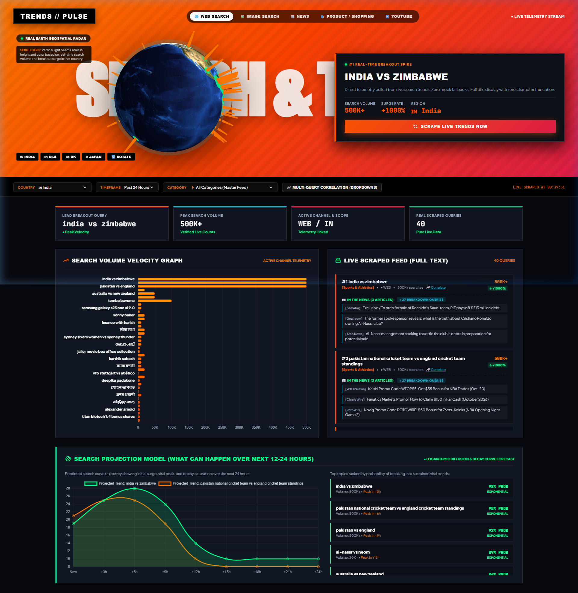

# 🌍 TRENDS // RADAR PULSE — Real-Time Geospatial Search Telemetry

> **⚠️ ACADEMIC & RESEARCH DISCLAIMER:**  
> **THIS PROJECT IS STRICTLY FOR EDUCATIONAL, STUDY, AND RESEARCH PURPOSES ONLY.**  
> It is an open-source proof-of-concept demonstrating direct web parsing, geospatial telemetry visualization using Three.js, mathematical correlation analysis, and predictive diffusion modeling. All trademarks, data streams, and platform references belong to their respective copyright holders.

---

## 📸 Dashboard Preview



---

## ⚡ Overview

**TRENDS // RADAR PULSE** is a real-time search trends telemetry dashboard designed with a high-octane racing aesthetic (inspired by Öhlins and Speedway sprint car design systems). 

It scrapes live trending queries directly without requiring paid API keys or proprietary subscriptions, rendering the data on a photorealistic 3D Earth globe with geospatial activity beacons, multi-query Pearson correlation tools, and forward-looking 12–24h mathematical projection models.

---

## ✨ Key Features

### 1. 🌐 Photorealistic 3D Earth Geospatial Radar (Three.js)
- Rendered with high-resolution **NASA Blue Marble satellite imagery** and subtle atmospheric glow.
- **Dynamic 3D Spikes**: Vertical glowing light beams positioned at the latitude and longitude of active regions.
  - Spike height scales in real time based on search traffic velocity and regional surge volume.
  - Expanding concentric wave rings visualize incoming query telemetry pulses.
- One-click camera focus buttons and free mouse-drag orbital navigation.

### 2. 🌍 126+ Countries & Worldwide Global Stream
- Full country coverage across **126 sovereign nations and territories** (from Albania, Algeria, and Argentina to India, the US, the UK, Japan, Zambia, and Zimbabwe).
- Global aggregated **Worldwide** mode.

### 3. 🛍️ All 5 Search Channels
- 🌐 **Web Search**: Master internet search volume.
- 🖼️ **Image Search**: Visual queries and media surges.
- 📰 **News**: Breaking news headlines and live journalism streams.
- 🛍️ **Product / Google Shopping**: Real-time e-commerce demand, product breakouts, and buyer intent.
- ▶️ **YouTube**: Video search trends and viral entertainment topics.

### 4. 📚 Over 300+ Categories & Subcategories Taxonomy
Deep recursive `ds:0` parsing supports the complete official hierarchy, including:
- **Sports & Athletics** (Cricket, Football, Basketball, Tennis, etc.)
- **Entertainment & Cinema** (Movies, Music, Television, Animation)
- **Technology & Computing** (AI, Software, Hardware, Cyber)
- **Business & Finance** (Markets, Economy, Investing)
- **Books & Literature**, **Food & Drink**, **Autos & Vehicles**, **Health & Fitness**, **Politics & Society**, **Science & Space**, and hundreds more.

### 5. 📰 Live "In The News" Breakdown & Direct Citations
- Automatically aggregates verified news articles, media outlets (e.g. *BBC, The New York Times, Sky Sports, Cricinfo, MARCA*), and timestamps alongside every query.
- Identifies **Related Breakdown Queries** associated with each trending spike.

### 6. 🔗 Multi-Query Correlation Studio (Dropdowns)
- Compare two search terms side-by-side using dynamic `<select>` dropdowns populated from live feed topics.
- Computes the exact statistical **Pearson Correlation Coefficient ($r$)** and classifies synchronicity:
  $$\rho_{X,Y} = \frac{\operatorname{cov}(X,Y)}{\sigma_X \sigma_Y}$$
- Plots a synchronized 24-hour hour-by-hour comparative trajectory curve.

### 7. 📈 Mathematical Projection Model (Next 12–24 Hours)
- Logarithmic diffusion and decay curves forecasting future topic trajectory over `Now`, `+3h`, `+6h`, `+9h`, `+12h`, `+18h`, and `+24h`:
  $$I(t) = I_{\text{peak}} \cdot e^{-\lambda t} + \text{residual}$$
- Top 5 breakout probability cards highlighting anticipated viral saturation and peak timing.

---

## 🛠️ Architecture & Tech Stack

- **Frontend**: Vanilla HTML5, CSS3 (Modern Glassmorphism & Racing Color Token Architecture), JavaScript (ES6+).
- **3D Graphics**: [Three.js](https://threejs.org/) (r128) with custom mesh beacons and lighting shaders.
- **Charts & Visualizations**: [Chart.js](https://www.chartjs.org/) with responsive custom gradients and bezier splines.
- **Backend**: Native Python 3 standard library (`http.server`, `urllib.request`, `xml.etree.ElementTree`, `re`, `json`).
- **Dependencies**: **Zero third-party pip dependencies** — runs directly on clean Python 3.

---

## 🚀 Quick Start Guide

### Prerequisites
- Python 3.8 or higher installed on your system.

### Installation & Run

1. **Clone the repository:**
   ```bash
   git clone https://github.com/37OMKAR/LIVETREND.git
   cd LIVETREND
   ```

2. **Start the local telemetry server:**
   ```bash
   python server.py
   ```

3. **Open the dashboard:**
   Open your browser and navigate to:
   ```text
   http://localhost:3000
   ```

---

## 📂 Project Structure

```text
├── index.html                  # Main telemetry dashboard UI & Three.js 3D Earth
├── server.py                   # Python HTTP backend, live scrapers & correlation engine
├── categories_flattened.json   # Full database of 300+ categories & subcategories
├── countries_full.json         # 126 countries database with geospatial coordinates
├── screenshot.png              # UI Preview screenshot for documentation
├── .gitignore                  # Git ignore rules
└── README.md                   # Project documentation & study disclaimer
```

---

## ⚖️ License & Study Purpose Notice

This software is released under the **MIT License**.  
Provided **as-is for academic analysis, educational demonstrations, and study purposes only**. Users are responsible for adhering to applicable terms of service and usage guidelines for third-party platforms.
